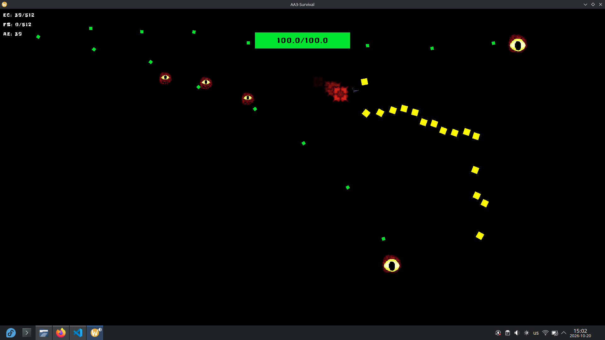

# AA3 Survival


Quick game I threw together to learn new game development concepts - basic ECS and event handler. The game contains the player, enemies and projectiles which all are entities and all damage is done through events.

## Building
This game depends on C++17, [Raylib](https://www.raylib.com/) and [SRU-Lib](https://github.com/Acerx-AMJ/SRU-Library). SRU-Lib is fetched automatically by CMake and that is the preferred way of building.
```bash
cmake -B build
cmake --build build
```
After, the executable will be located in `build/aa3survival`. Simply run it after building. Assets folder must be in the same folder as the game is ran in.

## Credits
This project, including all assets except for fonts, was made by Daniel Vishnevsky and is licensed under MIT License.
